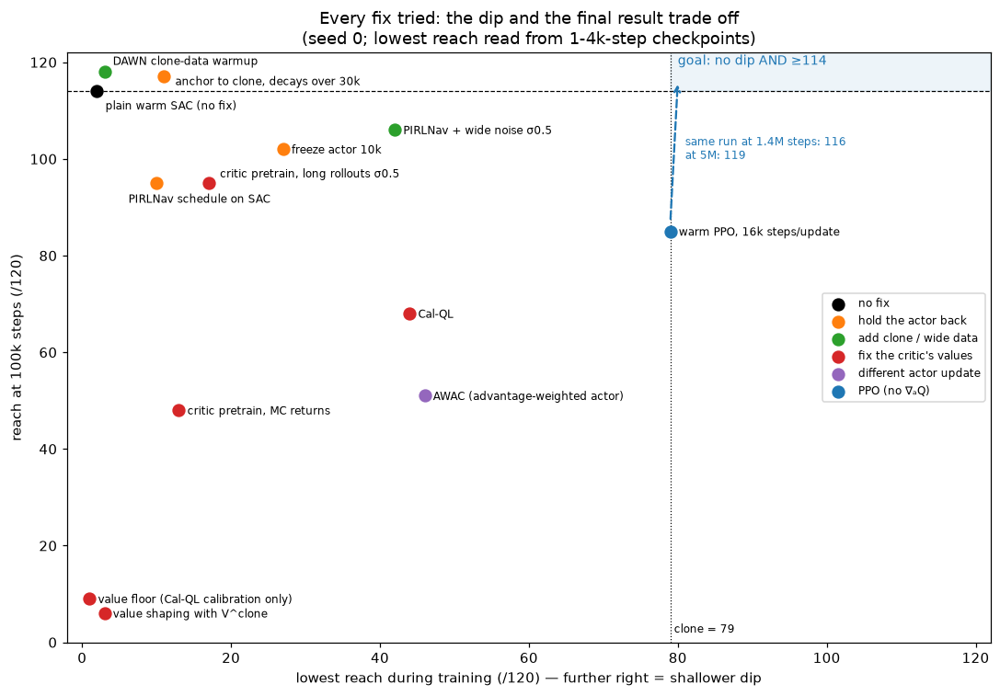
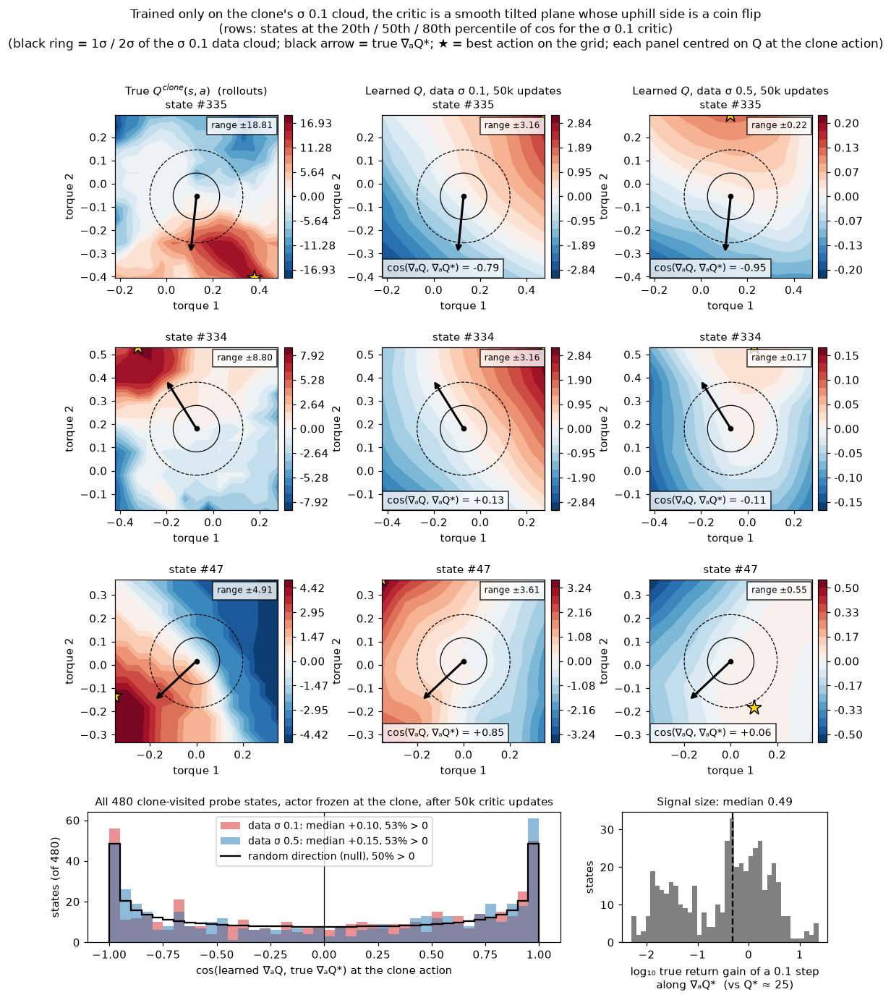
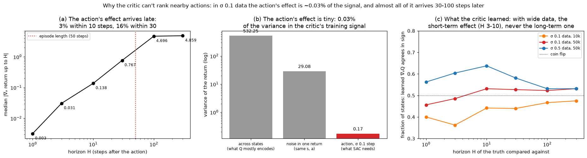
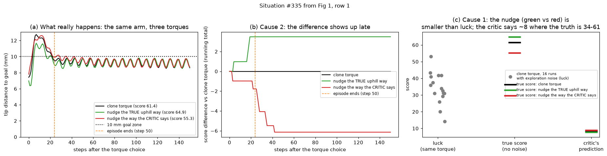
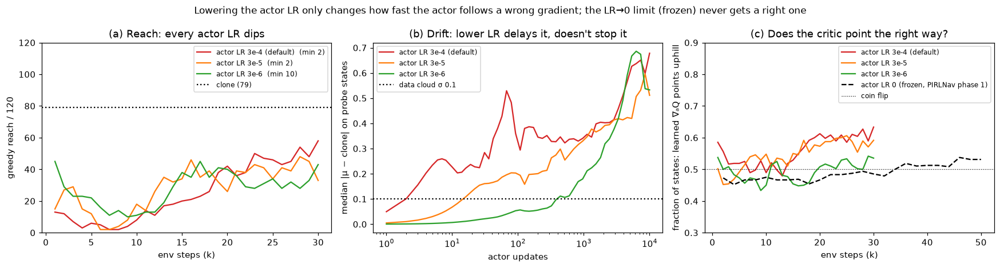
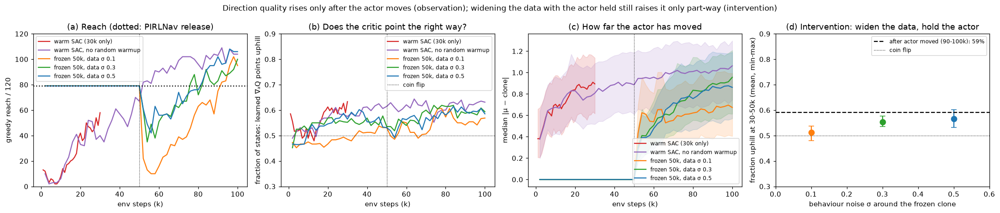

# 19. The warm-start dip — why the critic can't steer

## Decision

The warm-started SAC actor collapses from the clone's **79/120 to 2/120 within
~7k steps** ([journey 16](16-warm-start-rl.md), P3). Thirteen fixes were tried,
and every one of them landed on the same trade-off: **avoid the dip, or improve
past the clone — never both.** The mechanism, now measured rather than guessed, is
two-part:

1. **The critic can't tell which nearby action is better.** At the states the
   clone visits, its action gradient points uphill on **53%** of states, against
   50% for a random direction, even after 50k updates of training on clone data.
   The thing it would have to learn is **tiny** (0.03% of the variance in its
   training signal) and **late** (84% of an action's effect arrives 30+ steps
   after the action).
2. **SAC follows that gradient fast.** Two Adam updates already move the actor
   outside the σ = 0.1 cloud of actions the critic was trained on. A lower learning
   rate only slows the drift; it doesn't change the direction.

No configuration tried meets the target: none both avoids the dip and still
reaches 114/120. **Every number is seed 0.**

??? info "Reading guide for readers new to RL"

    - **Actor (policy)**: the network that picks the torque, given what the robot sees.
    - **Warm start**: instead of starting the actor from random weights, copy in the
      weights of the **clone**, a network trained by imitation to copy the DeePC
      expert ([journey 07](07-imitation-learning.md), [16](16-warm-start-rl.md)).
      At step 0 the actor *is* the clone: 79 of the 120 test scenarios reached.
    - **Critic (Q-function)**: a second network that predicts the total future
      score of taking torque `a` in situation `s`, written `Q(s, a)`. It is
      learned from experience and starts out random.
    - **SAC** (the algorithm used so far) improves the actor by asking the critic,
      "if I nudge the torque a little, does the predicted score go up or down?"
      That slope is the **action gradient** `∇ₐQ`. The actor moves whichever way
      the critic says is up.
    - **Reach rate**: of 120 frozen test scenarios, how many the deterministic
      (no-noise) policy brings within 10 mm of the goal. **Return**: the summed
      reward of a training episode, with the exploration noise left in.
    - **The dip**: the reach rate falls far below the clone's 79 right after RL
      starts, then recovers.

## Context

[Journey 16](16-warm-start-rl.md) measured the dip and called it harmless at that
budget: the warm arm still finished first (114/120 at 100k). It also showed both
pre-registered remedies, freezing the actor and pretraining the critic, doing
worse than doing nothing. Two things kept the question open.

- **A warm start that first destroys the prior is a warm start in name only.**
  For ~20k steps the policy is far *worse* than the network it was copied from. In
  simulation that costs nothing. On hardware those are thousands of bad episodes.
- **None of the fixes had a mechanism behind it.** Each was a guess at a cause
  (bad Q values, missing data, an actor that moves too early), and each failure
  only ruled that one guess out.

The target was fixed up front: **no dip** (stay near 79/120) **and at least the
cold arm's 114/120**.

## What was tried, and the pattern

Each point is one run. The x-axis is how deep the dip went (the lowest reach
during training), and the y-axis is where the run stands at 100k steps. The goal
is the shaded top-right corner. Lowest reach is read from 1–4k-step
checkpoints; journey 16's freeze run was swept at 10k, so its 27 is an upper bound.

| family | fix | lowest | @100k | what happened |
| --- | --- | --- | --- | --- |
| — | plain warm SAC (journey 16) | 2 | 114 | dips, then recovers best of all |
| — | same, no uniform-random warmup (`--learning-starts 0`) | 2 | 104 | random warmup actions are *not* the cause |
| hold the actor | freeze 10k (journey 16) | ≤27 | 102 | holds 79 while frozen, collapses at release |
| hold the actor | anchor `λ‖μ−μ₀‖²`, λ decays over 30k | 11 | 117 | holds while λ>0, collapses at release |
| hold the actor | PIRLNav critic-first schedule, on SAC | 10 | 95 | holds 79 for 50k, collapses to 10 at release |
| hold the actor | actor LR 3e-5 / 3e-6 | 2 / 10 | — | dip delayed, not avoided (30k runs) |
| hold the actor | entropy coef 0 / 0.01 | 4 / 7 | — | drifts *more* without entropy (30k runs) |
| fix the critic's values | pretrain critic on MC returns | 13 | 48 | random actions score higher than the clone's |
| fix the critic's values | pretrain on long-horizon rollouts, σ 0.5 | 17 | 95 | — |
| fix the critic's values | potential shaping with `V^clone` | 3 | 6 | V's jitter swamps the reward |
| fix the critic's values | value floor (Cal-QL's calibration alone) | 1 | 9 | Q overshoots; dips as hard as control |
| fix the critic's values | Cal-QL | 44 | 68 | softer dip, caps far below |
| add data | DAWN (20k clone transitions in the buffer) | 3 | 118 | dip unchanged (on the residual arm it fixes the slow recovery: [journey 20](20-residual-cold-critic.md)) |
| add data | PIRLNav + σ 0.5 noise while frozen | 42 | 106 | best SAC mitigation; dip shallower, not gone |
| actor update | AWAC (advantage-weighted regression) | 46 | 51 | no deep dip, no learning |

The reward change of journey 16's era (unified DeePC-form reward) also left the
dip unchanged and was rolled back.

**The pattern.** Every run that avoids the dip also stops improving (Cal-QL,
AWAC). Every run that improves dips first, including the ones that only *delay*
the actor (freeze, anchor, PIRLNav). That is what you'd expect if the critic
never learns, from clone-like data, which way is better, and whatever eventually
teaches it requires the actor to move first. The rest of this entry tests that
hypothesis directly.

## Finding the cause

### Step 1 — measure the true "uphill" direction

The critic's action gradient can't be judged without the right answer, and in
simulation the right answer can be computed.

- **Probe states.** 480 states the clone actually visits: steps 1, 5, 12 and 25 of
  each of the 120 frozen scenarios.
- **Truth by finite differences.** At each state, nudge torque 1 by ±0.1, then
  torque 2 by ±0.1. After each nudge, let the clone drive for 300 steps and add
  up the discounted reward (γ = 0.99). The differences give the **true uphill
  direction** `∇ₐQ*`. The simulator is deterministic, so this needs no averaging:
  2,400 rollouts of 26 ms each.
- **The metric.** The fraction of states where the critic's gradient and the
  true one point into the same half-plane, i.e. their cosine is positive. A
  random direction scores **50%**.

!!! note "Why not the median cosine"

    An earlier draft of this investigation reported median cosines (≈0.2 for wide
    exploration noise, 0.3–0.4 at recovery). In 2-D, the cosine between *random*
    directions is not spread evenly: it piles up near ±1 (an arcsine
    distribution), so a median of +0.2 can sit very close to chance. The
    fraction-uphill metric has an obvious null, and the effects shrink under it.
    The conclusions survived; the effect sizes did not.

### Step 2 — the critic's direction is a coin flip

Each row is one probe state. The rows sit at the 20th, 50th and 80th percentile
of agreement, so they're representative, not cherry-picked. Each panel shows
`Q(s, a)` over a ±0.35 grid of torques around the clone's action (the black dot):

- **Left:** the truth, from rollouts. It is lumpy, with swings of ±5 to ±19 within
  the grid, because the reach bonus (+1 per step inside 10 mm) makes nearby
  torques land in the goal zone on different steps.
- **Middle:** the critic after **50k updates with the actor frozen at the clone**,
  the best case for it, since its data is exactly the clone ± 0.1. It is a smooth
  tilted plane, and the tilt points the wrong way about half the time.
- **Right:** the same, with exploration noise widened to σ 0.5. Flatter, and still a
  coin flip.

Over all 480 states (bottom-left), both critics point uphill on **53%** of states,
against a 50% null drawn as the black curve. The learning-rate figure in Step 4 (panel c) follows this over
training: plain warm SAC, every actor learning rate tested, and the frozen-actor
critic all sit at 45–55% through the dip.

#### The same test with no gradients at all

The simplest form of the check needs no finite-difference theory. At each of the
480 states, move the clone's torque **0.1 in the direction the critic
recommends**, roll it out in the simulator, and see whether the true score
went up.

| direction followed | score rises on | median change |
| --- | --- | --- |
| true uphill direction (validates the truth) | **90%** of states | +0.29 |
| critic, actor frozen, 50k updates | 53% | +0.00 |
| warm SAC critic at 2k (dip starting) | 54% | +0.00 |
| warm SAC critic at 5k (bottom of the dip) | 52% | +0.00 |
| warm SAC critic at 30k (recovering) | 60% | +0.01 |
| random direction | 50% | −0.00 |

During the dip, following the critic is indistinguishable from following a random
direction. The true direction works 90% of the time, so the yardstick itself is
sound.

### Step 3 — why: the action's effect is tiny, and it's late

The critic learns from records of the form (situation, torque used, score that
followed). It **never** sees two torques tried from the same situation. To learn
which nudge is better, it has to pull that effect out of everything else that
varies between records. Two measurements show why it can't.

**Cause 1 — tiny (panel b).** This is what varies in the score the critic is
trained on, for clone ± 0.1 data, measured with 16 noisy rollouts per probe state:

| source of variation | variance | share |
| --- | --- | --- |
| which situation it is (arm near or far from the goal) | 532 | 95% |
| luck: exploration noise on the later torques | 29 | 5% |
| **a 0.1 torque nudge — the part SAC needs** | **0.17** | **0.03%** |

Regression fits the large parts first: which situations are good (the critic does
learn this, correlating 0.67 with the truth), then the luck. The nudge effect is
a whisper next to a shout. Whatever slope the network ends up with is a side
effect of fitting the other two. Even the one-step effect of a torque (its control
cost) isn't learned, because at 0.003 it is ~10⁴ times smaller than the noise. The
critic agrees with that one-step gradient on only 46% of states.

**Cause 2 — late (panel a).** This is the size of the torque's effect when the
return is cut off H steps after the nudge:

| H (steps after the nudge) | 1 | 3 | 10 | 30 | 100 | 300 |
| --- | --- | --- | --- | --- | --- | --- |
| median effect on return | 0.003 | 0.031 | 0.14 | 0.77 | 4.70 | 4.86 |

Only 3% of the effect has arrived after 10 steps, and 16% after 30. The rest comes
when the arm does or doesn't settle inside the goal zone. A TD critic learns by
chaining "score here = reward now + my estimate for the next step", so that
information travels back **one link per round of learning**, and an episode is
only 50 steps long. After 50k updates the frozen-actor critic predicts **−1.4**
for states whose true value is **+21.3**. The far end of the chain, where the
action's effect lives, hasn't arrived.

**Panel (c) shows both causes at once.** With 25× more action spread in its data
(σ 0.5), the critic matches the *short-term* truth best: 64% at H = 10. Against
the long-term effect (H ≥ 100), which is what decides the outcome, it falls back
to 53%. Making the signal louder fixed only the part that had already arrived.

#### One situation, made concrete

State #335, from the top row of the landscape figure: step 25 of 50, with the tip
already 7 mm from the goal.

| torque | steps inside 10 mm (of 151) | true score | critic says |
| --- | --- | --- | --- |
| clone (0.13, −0.05) | 133 | 61.4 | 8.32 |
| nudged the truly uphill way | 137 | **64.9** | 7.75 |
| nudged the way the critic says is uphill | 125 | **55.3** | 8.84 |

- The tip wobbles across the 10 mm line (panel a). The torque only changes **how
  many steps** it spends inside, so the score differences arrive in ±1 jumps 3 to
  41 steps after the choice (panel b).
- On step 1 the three torques score identically.
- The same clone torque, run 16 times with exploration noise, scores anywhere from
  **14 to 53** (panel c). The critic sees roughly one such record of this
  situation.
- The critic ranks the three torques exactly backwards, and its level (~8) is
  ~26 below the noisy-policy truth (34).
- One SAC update moves the torque toward the red one.

#### Explanations that were tested and ruled out

| hypothesis | test | result |
| --- | --- | --- |
| The critic chases the wrong target: it learns the *noisy* policy's value, the truth is the deterministic clone's | recompute the truth with exploration noise (16 seeds, common random numbers) | the two truths agree on 78% of states; the critic agrees with its *own* noisy target on only 54% |
| The uphill direction is unlearnable: it flips between neighbouring states | true gradient at consecutive time steps | same sign 84% of the time (t vs t+1), 67% five steps apart: smooth enough to generalize |
| The critic uses the action as a stand-in for the state (the clone's torque spread, 0.41 per axis, is 4× the noise) | give each state another state's clone action | the critic's response tracks the other state's value with r = +0.17: weak |
| SAC's `min(Q1, Q2)` in the actor loss randomizes the gradient by switching between the two critics | rerun the gradient-free step test with Q1 only, Q2 only, the min and the mean | all four 50–54% at 2k and 5k, 59–60% at 30k; the two critics' slopes agree (median cosine 0.77–0.94), and each is the lower one on ~50% of states |

### Step 4 — why SAC is hurt so quickly, and the learning-rate question

A coin-flip gradient would be harmless if the actor barely followed it. It
doesn't barely follow it.

- **Speed (panel b).** Adam normalizes each weight's step to roughly the learning
  rate, whatever the gradient's size. The warm actor has 77k weights, and
  coherent steps add up. The median action drift without random warmup: **0.05
  after 1 update, 0.23 after 10**. It crosses the σ = 0.1 data cloud after
  **~2 updates**, and reaches 0.5–0.7 by 10k.
- **Lower learning rates (panels a, b).** 3e-5 and 3e-6 cross the cloud at ~15
  and ~400 updates instead of ~2, and all three end up at the same drift by 10k.
  All three dip (lowest 2, 2, 10).
- **The zero-learning-rate limit is already measured (panel c).** That is the
  frozen phase of PIRLNav: 50k steps, and the critic is still at coin flip. Giving
  the critic more time on clone data doesn't produce a usable gradient, so there
  is no learning rate at which waiting works.
- **A confound found along the way.** SB3's default `learning_starts=100` fills
  the replay buffer with 100 uniformly random actions before learning, in every
  warm run except DAWN. These drive much of the very first drift (0.56 vs 0.24
  after 10 updates). With them removed (`--learning-starts 0`), the run still dips
  to 2 and ends at 104.

### Step 5 — the recovery is an observation, not a cause

In every run, the critic's agreement rises from ~50% to ~60% only **after** the
actor has moved 0.6–1.0 away from the clone (panels b, c). That is a correlation:
it describes how runs recover, not why they dip. The one causal test is panel (d):
hold the actor at the clone and widen only the data.

| exploration noise σ, actor frozen (30–50k) | uphill fraction |
| --- | --- |
| 0.1 | 51% |
| 0.3 | 55% |
| 0.5 | 57% |
| *after the actor has moved (90–100k), any run* | *59%* |

So wider action data accounts for most of what moving buys. But 59% is still a
weak critic, and SAC recovers with it only because, by then, it has had tens of
thousands of updates to average over.

### The mechanism in one paragraph

Warm-start RL dips because SAC improves the actor by following the critic's
action gradient, and near the clone that gradient is no better than random
(right on 52–54% of states, Step 2). The critic can't learn it. The effect of a
torque on the return is tiny (0.03% of the variance), arrives 30+ steps later, and
is buried in the randomness of the rest of the episode (Step 3). The pre-trained
actor plus small exploration noise gives too few action comparisons to beat that
noise, and adding more noise adds randomness as fast as it adds comparisons.
Meanwhile Adam moves the actor at full size, about 0.05 per update and 0.38 after
1k (Step 4), so a random direction plus a big step destroys the clone within ~1k
steps. The policy later recovers mostly by finding a **different** solution
(torques 0.9 from the clone's), much as cold-start RL would. The critic does
improve on the wider action data it now sees, but only to ~60% (Step 5). It
never learns the clone's neighbourhood well.

Four ways this is easy to misstate:

| tempting statement | more accurate |
| --- | --- |
| "The critic's action gradient causes the dip." | It takes **two** things together: a near-random direction *and* a big step. A random direction with tiny steps does little harm; a big step in a reliable direction would improve the policy. |
| "The gradient misguides the actor." | It doesn't *guide* it: at 52–54% it is uninformative, not opposite. The exception is DAWN's clone-only warmup data, whose critic is slightly worse than random (40–45%). |
| "There is too little exploration, so too few torques to compare." | Too few comparisons **relative to the noise**. A single comparison is right about 52% of the time, and ~600 tries per torque would be needed for 90%. More noise widens the data but also randomizes every return: σ 0.5 data lifts the frozen critic only to 57% (Step 5), and it softens the dip without removing it (PIRLNav lowest 42; DAWN with noisy warmup, lowest 6). |
| "Later, the accumulated exploratory torques let the critic compute the gradient well." | Only modestly: 52% at 5k, 60% at 30k, while reach climbs from 6 to 58. Recovery leans more on the policy moving to a new solution, plus tens of thousands of updates averaging a weak signal. |

### How this explains every failed fix

- **Fixing the critic's values** (pretraining, shaping, value floor, Cal-QL)
  changes Q's level, not its action slope. Adam then erases the gradient's scale,
  so only the direction matters, and the direction is still a coin flip. Cal-QL
  and AWAC avoid the dip only by refusing to move: no dip, no improvement.
- **Holding the actor back** (freeze, anchor, PIRLNav, low LR) trains the critic
  longer on clone-like data, which by Step 2 doesn't teach it the gradient. At
  release the same collapse happens.
- **Adding data** helps a little only when the data has *action contrast* (σ 0.5
  noise: lowest 42 instead of 10). Clone-only data (DAWN) doesn't: its critic's
  slope is right on only 40–45% of states at 2k–10k, slightly worse than random.
  The reason it falls below chance wasn't measured.

!!! note "Corrections made during the investigation"

    - "The dip is a Q-scale problem" — retracted: a calibration-only value floor
      raised Q *above* the truth and the run dipped just as hard.
    - Median cosines replaced by fraction-uphill (see Step 1).
    - "The true landscape is rugged" was overstated. It is rugged across
      *actions* (reach-bonus cliffs) but smooth along a trajectory (84%
      step-to-step agreement), so unlearnability was ruled out.
    - The `learning_starts=100` random warmup confounds every earlier warm run's
      first-updates drift, but not the dip itself.

## Considered

Options from the literature that attack the two causes **inside** an off-policy
learner, and so might keep SAC's sample efficiency. None has been run.

| idea | targets | source |
| --- | --- | --- |
| **JSRL**: the clone drives the first h steps of each episode, h shrinks over training | cause 2: RL starts where effects show up within a few steps; the clone keeps control elsewhere | Uchendu et al., ICML 2023, [arXiv:2204.02372](https://arxiv.org/abs/2204.02372) |
| **Q-chunking**: the critic scores h-action chunks, with unbiased h-step backups | cause 2: the 41-link chain becomes ~41/h links | Li, Zhou, Levine, NeurIPS 2025, [arXiv:2507.07969](https://arxiv.org/abs/2507.07969) |
| **Bounded residual + progressive exploration** (Policy Decorator) | the speed problem: a wrong critic can only move the torque by the bound | Yuan et al., ICLR 2025, [arXiv:2412.13630](https://arxiv.org/abs/2412.13630) |
| **IBRL**: the clone proposes an action at every step; act and bootstrap with the Q-argmax | protects the prior, but still ranks with the same critic | Hu et al., RSS 2024, [arXiv:2311.02198](https://arxiv.org/abs/2311.02198) |
| **MCAC**: critic target = max(TD, Monte-Carlo return) | cause 2, but risks the off-manifold overestimation that sank MC pretraining here | Wilcox et al., NeurIPS 2022, [arXiv:2210.07432](https://arxiv.org/abs/2210.07432) |
| **WSRL**: warm-up rollouts from the frozen policy | Q *calibration*: already covered here by DAWN / `--learning-starts 0` / PIRLNav, and calibration isn't the problem | Zhou et al., ICLR 2025, [arXiv:2412.07762](https://arxiv.org/abs/2412.07762) |

The PIRLNav schedule is from Ramrakhya et al., CVPR 2023.

## Outcome

- **Code.** The failed fixes' code was removed on 2026-11-03, PPO included:
  actor freeze, anchor, PIRLNav, critic pretraining (both forms), `V^clone`
  shaping, value floor, Cal-QL, AWAC and sac-hard. The results above can no
  longer be re-run from this tree. Still in `scripts/train/train_reacher_window.py`:
  `--learning-starts`, `--actor-lr`, `--ent-coef`, and DAWN's `--warmup-steps`
  and `--critic-layernorm`.
- **Data.** Every run's checkpoints, monitors and per-scenario sweeps are under
  `data/repro/` (gitignored), including `pirlnav_*`, `dip_w_*`, `awac_*` and `sac_ls0`.
- **Not committed.** The gradient probes (finite-difference truth, per-checkpoint
  alignment, landscapes, horizon decomposition) and the plotting scripts for this
  entry's figures were run from a session scratchpad. The figures are the record.
  Regenerating them needs those scripts brought into `scripts/`.
- **What would change the conclusions:** more seeds for the fraction-uphill
  numbers, and one of the off-policy options above reaching
  the goal corner at SAC's sample cost.
