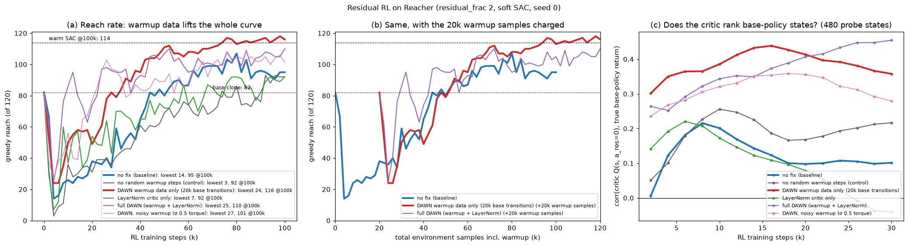
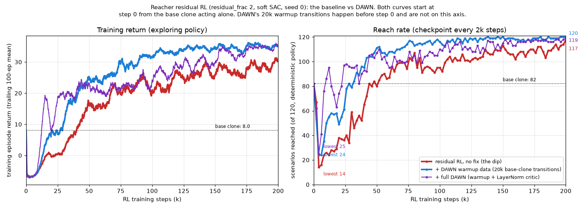
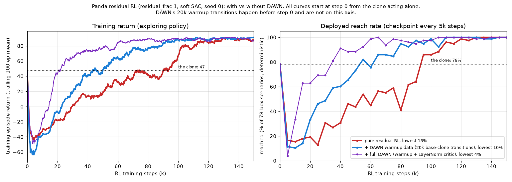
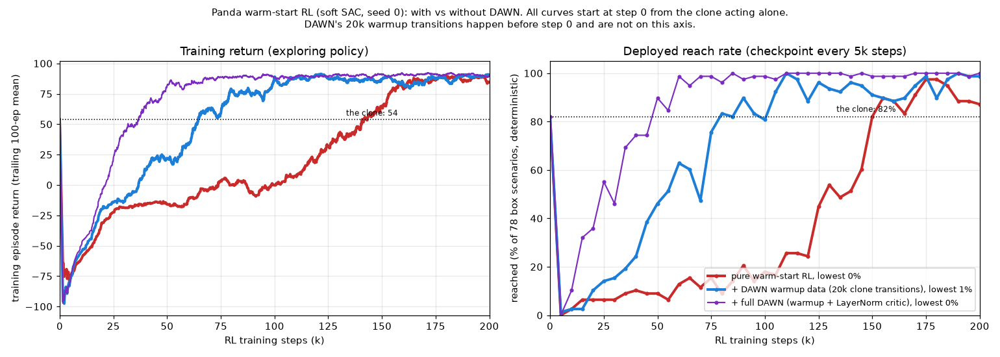
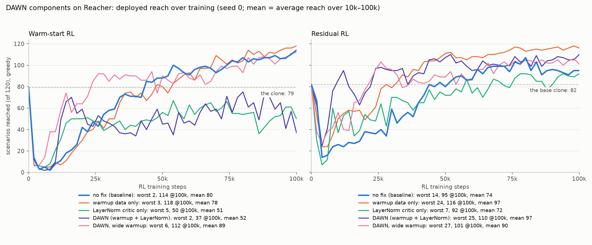

# 20. Residual RL's cold critic — DAWN's data-anchored warmup

## Decision

The Reacher residual arm ([journey 13](13-reacher-residual.md)) starts with an
**untrained critic**. Its reach falls from the base clone's **82/120 to 14/120
within 4k steps**, and it is still at **95/120 at 100k**, 19 scenarios behind the
warm-start arm. Seeding the replay buffer with **20k transitions of the base clone
acting alone**, the data-anchored warmup of **DAWN** (Ma et al., *What Makes Value
Learning Efficient in Residual Reinforcement Learning?*,
[arXiv:2602.10539](https://arxiv.org/abs/2602.10539)), fixes the slow recovery:

- **116/120 at 100k**, or 113 with the 20k warmup samples charged to the budget.
  The average reach over 10k–100k rises from 74 to 97.
- Measured mechanism: the critic ranks base-policy situations far better from its
  first checkpoint (correlation with the true return 0.30–0.44, against 0.01–0.22).
- A matched control rules out the confound that the warmup also switches off
  SB3's 100 random-action steps.

It **does not remove the dip** (lowest 24 instead of 14). DAWN's other half, a
LayerNorm critic, **doesn't help here** (92 alone, 110 combined), because our
residual has no scale mismatch for it to fix. The same warmup also leaves the
**warm-start** dip untouched, for a reason taken apart in
[journey 19](19-warm-start-dip.md) and summarized below. **Every number is seed 0.**

**On the Panda** ([journey 18](18-panda-box-rl.md)'s arms), DAWN still leaves the
dip in both arms, but speeds the recovery far more, and there LayerNorm *helps*.
Full DAWN brings the residual back to the clone's level at 35k steps instead of
95k, and the warm start at 50k instead of 150k. See
[DAWN on the Panda](#dawn-on-the-panda) below.

??? info "Reading guide for readers new to RL"

    - **Residual RL**: keep a good controller frozen (here the DAgger clone of the
      DeePC expert, the **base policy**, 82/120 on its own) and learn a small
      **correction** on top: `u = u_base + 2 · a_res`. The correction network
      starts at zero, so at step 0 the system *is* the base clone.
    - **Critic**: the network that predicts the total future score of an
      (observation, correction) pair. SAC improves the correction by asking the
      critic which way to nudge it. A brand-new critic is random, so its early
      advice is random too.
    - **Replay buffer**: the store of past transitions the critic trains on. DAWN's
      warmup pre-fills it with transitions in which the correction is exactly zero,
      i.e. the base clone driving on its own, and keeps them there all run.
    - **Reach rate**: of 120 frozen test scenarios, how many the deterministic
      policy brings within 10 mm of the goal.

## Context

Journey 13 tuned the residual arm (`--residual-frac 2.0`, soft SAC) for its
**400k** result (119/120), and [journey 16](16-warm-start-rl.md) then measured it
against the warm-start arm at 100k: **95/120 against 114/120**. The residual's
early curve shows why. It collapses from 82 to 14 in 4k steps, crawls back
through the 20s and 30s until ~25k, and only crosses the base clone again at
~45k.

That is the failure the DAWN paper names the **cold start pathology**: "the
critic lacks knowledge of the value landscape around the base policy". Residual
learning only ever explores near the base policy, so a critic that doesn't
quickly learn values *there* misleads the correction from the first update.

## What the paper proposes

DAWN (Data-Anchored Warmup and Normalization) has two parts, each aimed at one
bottleneck:

| bottleneck (paper's term) | what goes wrong | DAWN's fix |
| --- | --- | --- |
| **cold start pathology** | the random critic knows nothing about values near the base policy | **data-anchored warmup**: "before training, collect M transitions using the base policy alone and store them in the replay buffer" (M = 20k by default) |
| **structural scale mismatch** | the critic sees `a_base + λ·a_res` with λ ≈ 0.1, so the residual is a tiny part of its input | **critic normalization**: LayerNorm in the critic |

Two of the paper's findings match what this repo had already hit:

- **Explicit critic pretraining is "redundant"** and often harmful. With soft Q,
  the entropy term dominates (`|α log π| ≫ |r|`) and the Q-values collapse; with
  hard Q, the targets no longer match those of the soft-Q training that follows.
  Here, journey 16's MC-return pretraining scored 33/120, and PIRLNav's soft-target
  phase fit Q ≈ −173 against a true ≈ +23 ([journey 19](19-warm-start-dip.md)).
- **The base policy alone beats exploratory warmup data.** The anchor is about
  grounding the critic where the policy will be, not about diverse coverage.

The paper reports DAWN reaching high success roughly **5× faster** than Policy
Decorator across ManiSkill and Adroit, with Diffusion Policy and BeT as base
policies, while vanilla residual RL often fails outright.

## What was run

`train_reacher_residual.py --clone data/dagger_clone_r3.pt --residual-frac 2.0
--steps 100000`, soft SAC, seed 0, a checkpoint every 2k, greedy sweep over the
120 frozen scenarios. DAWN's flags: `--warmup-steps 20000` (σ 0, the base clone
alone), `--critic-layernorm`, `--warmup-sigma`.



| residual arm | lowest | @100k | warmup charged (@80k RL steps) | mean 10k–100k |
| --- | --- | --- | --- | --- |
| no fix (baseline) | 14 | 95 | — | 74 |
| no random warmup steps (control) | 3 | 92 | — | 63 |
| **DAWN warmup data only** | **24** | **116** | **113** | **97** |
| LayerNorm critic only | 7 | 92 | — | 72 |
| full DAWN (warmup + LayerNorm) | 25 | 110 | 105 | 97 |
| DAWN with noisy warmup (σ 0.25 residual = 0.5 torque) | 27 | 101 | 105 | 90 |
| *reference: warm-start SAC* | *2* | *114* | — | *80* |

**Charging the warmup.** The 20k warmup transitions are real environment samples,
and panel (b) shifts those curves right by 20k to count them. On that basis the
warmup arm is at 113/120 after 100k total samples, against the baseline's 95.

**The control.** `seed_replay_buffer` sets SB3's `learning_starts` to 0, because
the 100 uniform-random steps would only dilute the anchor. So the warmup arm
differs from the baseline in two ways. The control (`--learning-starts 0`, new on
this script) removes the random steps *without* adding warmup data. It does
slightly *worse* than the baseline (lowest 3, 92 at 100k), so the gain comes from
the anchor data.

### Over training episodes: the dip stays, the recovery speeds up



Both panels start at step 0 from the base clone acting alone (return 8.0, reach
82/120). DAWN's 20k warmup transitions are collected before episode 0, so they
are not on this axis.

| | no fix | DAWN warmup | full DAWN |
| --- | --- | --- | --- |
| lowest reach | **14** | 24 | 25 |
| reach back above the clone (82) | episode ~900 (45k) | episode ~560 (28k) | episode ~200 (10k), then unstable |
| reach at episode 2000 (100k) | 95 | **116** | 110 |
| return back above the clone (8.0) | episode ~800 (40k) | episode ~400 (20k) | episode ~250 (12k) |
| return at episode 2000 | ~21 | **~32** | ~23 |

- **The dip is still there.** All three collapse within the first 40–120 episodes
  (2k–6k steps). With DAWN it is shallower (24 instead of 14), but it is still a
  collapse from 82.
- **The recovery is what changes.** The warmup arm is back above the clone ~17k
  steps sooner than the baseline and keeps climbing, ending 21 scenarios higher.
  Full DAWN recovers earliest but swings (63 → 95 → 82 → 105) and ends below the
  warmup arm, consistent with LayerNorm having no scale mismatch to fix here.
- **The return's first drop is the same for all three, and it is mostly
  exploration.** For the first ~200 episodes all three curves sit at about −7.
  The residual's step-0 behaviour policy scores −7.5 when sampled: SAC's zero-init
  zeroes only the mean head, so the residual explores at σ ≈ 1 before the policy
  has changed at all. The curves separate only after that, as the critics differ.

## Why it works here — measured

The paper's diagnostic is **Q-grounding error**, `|Q(s, a_base) − G^base(s)|`, on
base-policy states. Here that is `Q(s, a_res = 0)` against the base clone's true
discounted return, computed by deterministic 300-step rollouts from 480 probe
states (steps 1, 5, 12 and 25 of every scenario; mean true return 32.9).

- **The absolute error doesn't separate the arms.** Every critic sits ~18 below
  the truth for the first 20k steps (Q ≈ 8–12 against 33). This differs from the
  paper's Figure 3. One likely reason is that soft SAC's entropy bonus shifts the
  whole Q level, and that shift says nothing about which situations it ranks
  higher.
- **The ranking does separate them (panel c).** The correlation across states
  between the critic's value and the true return:

| residual arm | corr, 2k → 20k |
| --- | --- |
| baseline | 0.01 → 0.22 → 0.10 |
| control (no random steps) | 0.05 → 0.26 → 0.17 |
| LayerNorm only | 0.14 → 0.22 → 0.08 |
| **warmup data** | **0.30 → 0.44 → 0.41** |
| full DAWN | 0.26 → 0.41 |

With the anchor in the buffer, the critic knows from its first checkpoint which
base-policy situations are good. Its advice to the correction is less wrong in
exactly the region where residual learning operates. That is the value-anchor
effect the paper describes, observed here as ranking, not as level.

## Why LayerNorm doesn't help here

The paper's scale mismatch comes from its critic input, `a_base + λ·a_res` with
λ ≈ 0.1, where a small residual is buried inside a large base action. This repo's
residual differs on both counts:

- **The critic sees the residual directly.** The SB3 action is `a_res`; `u_base`
  is part of the *observation* (`reacher/residual_env.py`), not added into the
  action.
- **The residual is large.** `residual_frac` is 2.0, so `a_res` can move the
  torque across the whole box.

There is no mismatch to restore, and LayerNorm measurably did not help: alone 92
(baseline 95), combined 110 (warmup alone 116). The paper's ablation shows each
half fixing its own bottleneck. Here only one of the two bottlenecks exists.

## Why the same fix doesn't remove the warm-start dip

The warmup was also run on the warm-start arm (the actor initialized to the
clone):

| warm-start arm | lowest | @100k |
| --- | --- | --- |
| no fix | 2 | 114 |
| warmup data only | 3 | 118 |
| LayerNorm only | 5 | 50 |
| full DAWN | 2 | 37 |
| DAWN with noisy warmup (σ 0.5) | 6 | 112 |

The dip is untouched. The reason is the difference between knowing **how good a
situation is** and knowing **which nearby action is better**.

- The anchor transitions are the prior acting with σ = 0, so every one carries
  exactly the clone's action. They teach the first thing, and here that cures
  the residual's slow recovery. They can't teach the second, because they contain
  no alternative actions to compare.
- [Journey 19](19-warm-start-dip.md) shows the warm-start dip is caused by the
  second. SAC moves the actor along the critic's action gradient, and near the
  clone that gradient points uphill on only 53% of states, a coin flip. The
  effect it would have to learn is 0.03% of the training signal and arrives 30+
  steps late.
- Journey 19 also ran the strongest version of this data: 50k updates with the
  actor frozen at the clone, i.e. purely clone data. The gradient stayed at coin
  flip. A 20k-transition anchor is a smaller dose of the same.
- LayerNorm has no residual scale to correct in the warm arm either, and there it
  hurt badly (37–50 at 100k). The mechanism of that harm wasn't measured.

The residual arm *also* still dips with the anchor (82 → 24). What DAWN fixed is
**how fast the residual recovers**, not the dip itself.

## DAWN on the Panda

The same three variants were run on the 7-DoF Panda
([journey 18](18-panda-box-rl.md)), for both arms: seed 0, soft SAC, a checkpoint
every 5k steps, each scored greedily on the 78 frozen box scenarios with the
harness the Panda results use. The warmup rolls the arm's prior acting alone for
20k transitions: the base clone (a zero residual) for the residual, the clone
itself for the warm start. As above, all curves start at step 0 from that prior,
and the warmup transitions are not on the x axis.





| Panda arm | variant | lowest | back to the clone | first 78/78 | at the end |
| --- | --- | --- | --- | --- | --- |
| residual (clone 61/78) | no fix | 10/78 | 95k | 130k | 78/78 (150k) |
| residual | DAWN warmup | 8/78 | 55k | 110k | 78/78 |
| residual | **full DAWN** | 3/78 | **35k** | **65k** | 78/78 |
| warm start (clone 64/78) | no fix | 0/78 | 150k | 300k (the original 400k run) | 68/78 (200k) |
| warm start | DAWN warmup | 1/78 | 80k | 110k | 77/78 |
| warm start | **full DAWN** | 0/78 | **50k** | **85k** | 78/78 |

- **The dip is still there in every Panda run,** as on Reacher. All six collapse
  to 0–10/78 within the first 5–25k steps.
- **The recovery is much faster, in both arms.** Full DAWN gets back to the
  clone 60k steps sooner on the residual and 100k sooner on the warm start, and
  reaches 78/78 in roughly half (residual) to a third (warm start) of the steps.
- **LayerNorm helps on the Panda, unlike Reacher.** It is the biggest single gain
  in both Panda arms, where on Reacher it was neutral (residual) or harmful (warm
  start, 37 at 100k). The warmup also speeds the Panda warm start, where on
  Reacher it did not. Why the two systems differ is not measured. No
  LayerNorm-only Panda run exists, so its effect is only seen on top of the warmup.
- **The re-runs reproduce journey 18.** Pure residual scores 34/78 and pure warm
  start 7/78 at 50k, as in the original 400k runs.

## Considered

- **Explicit critic pretraining** before the residual moves: not rerun. The paper
  and this repo's own journey 16 / 19 measurements agree it is redundant or
  harmful under soft SAC.
- **Noisy warmup** to add action contrast: run, and worse (101 vs 116). This
  matches the paper's "the base policy alone matches or exceeds all
  alternatives". The variance it adds outweighs the contrast.
- **Hyperspherical normalization** (the paper's alternative to LayerNorm): not
  run. With no scale mismatch present, neither normalization has anything to fix.

## Outcome

- **Code.**
  - `rl/sb3.py::seed_replay_buffer` (DAWN's warmup: rolls the prior, stores the
    transitions with time-limit cut-offs, sets `learning_starts = 0`),
    `LayerNormCritic`, `LayerNormSACPolicy`.
  - Flags `--warmup-steps`, `--warmup-sigma` and `--critic-layernorm` on both
    `train_reacher_residual.py` and `train_reacher_window.py`.
  - `--learning-starts` added to `train_reacher_residual.py` for the control.
  - The same three flags on `train_panda_rl.py` (residual and warm arms); its
    warmup rolls the step-0 actor's deterministic action, so one code path serves
    both. The Panda runs:

    ```bash
    uv run python scripts/train/train_panda_rl.py --arm warm --clone data/panda_clone_box_r2_squash.pt \
        --steps 200000 --checkpoint-freq 5000 --warmup-steps 20000 --critic-layernorm \
        --out data/panda_warm_dawnln_200k.zip
    ```
- **The command for the result:**

  ```bash
  uv run python scripts/train/train_reacher_residual.py --clone data/dagger_clone_r3.pt \
      --residual-frac 2.0 --warmup-steps 20000 --steps 100000
  ```

- **Data.** Under `data/repro/` (gitignored): `q_res`, `res_ls0`,
  `dawn_r_{warmup,ln,wide}`, `dawn_r` and the warm-arm `dawn_w*`, each with
  per-scenario sweeps `sweep_<name>.csv`.
- **Figures.** `figures/dawn_reach.png` (both arms) comes from
  `scripts/plot/plot_dawn.py`, and `figures/residual_dawn_episodes.png` from
  `scripts/plot/plot_dawn_residual_episodes.py`; `figures/panda_dawn.png` and
  `figures/panda_dawn_warm.png` from `scripts/plot/plot_panda_dawn.py --arm residual|warm`
  (its docstring has the checkpoint sweep; data `data/panda_{res,warm}_*`,
  `data/panda_dawn_sweep{,_warm}.csv`). `figures/residual_dawn.png` and the grounding probe
  were made from session-scratchpad scripts and are not committed.
- **What would change the conclusions:** more seeds, since 116 against 95 is
  large but single-seed, and journeys 13 and 14 show seed spreads of several
  scenarios. A 400k run would also tell whether the anchor changes the residual's
  asymptote (119/120) or only how fast it gets there.


